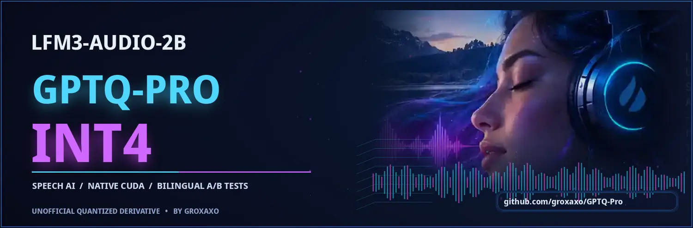

# LFM3-Audio-2B — GPTQ-Pro INT4 CUDA speech inference

<p align="center"><a href="https://huggingface.co/groxaxo/LFM3-Audio-2B-GPTQ-Pro-INT4"></a></p>

**Public model:** [groxaxo/LFM3-Audio-2B-GPTQ-Pro-INT4](https://huggingface.co/groxaxo/LFM3-Audio-2B-GPTQ-Pro-INT4)
**Quantization engine:** [groxaxo/GPTQ-Pro](https://github.com/groxaxo/GPTQ-Pro) (this repository)
**Experiment log:** [groxaxo/experimentos](https://github.com/groxaxo/experimentos/tree/main/speech-to-text/lfm3-audio-gptq-pro-int4-20261029) (private)
**Source:** [LiquidAI/LFM3-Audio-2B](https://huggingface.co/LiquidAI/LFM3-Audio-2B) at revision `9d49701c372d6011d900f6abb40c6b296fb706dd`

These are tested **model-specific inference scripts**, not native GPTQModel model-type registration. The INT4 artifact is a 755 MiB overlay of **142 packed projection layers** in the 24-layer language backbone. Original audio encoder, projector, depth decoder, codec, embeddings and sensitive modules stay BF16; the pinned original 3.9 GB checkpoint must also be available. The Hugging Face release provides the overlay, 24 weights checksums, and the exact vendored backend used for its original qualification.

## Measured on one RTX 3090 (29 Oct 2026)

| Task | Original BF16 | GPTQ-Pro INT4 |
| --- | ---: | ---: |
| Allocated model tensor GPU memory | 3.683 GiB | 1.699 GiB |
| Human EN ASR WER, 50 FLEURS recordings | 4.554% | 4.926% |
| Human ES ASR WER, 50 FLEURS recordings | 2.542% | 3.098% |
| EN ASR generation RTF | 0.0348 | 0.0387 |
| ES ASR generation RTF | 0.0361 | 0.0408 |
| EN TTS generation RTF, 5 phrases | 0.2721 | 0.2701 |
| ES TTS generation RTF, 5 phrases | 0.2535 | 0.2660 |

**RTF = generation seconds / input or output audio duration**, *lower is faster*. These measurements exclude audio decoding, capture, network, speech turn detection and any SIP/telephony integration. INT4 reduced allocated tensors by **53.87%** but was slower for ASR; no calls-per-second improvement is proven.

**Quality:** 10 paired English/Spanish synthetic voice clips produced 96.7% BF16-model ASR roundtrip word recall for both variants in English, and 98.6% BF16 / 94.3% INT4 in Spanish. This is a correlated model-based intelligibility proxy — **not MOS, blind listening, voice similarity or human listening preference**. Spanish ES_01 regressed to 71.4% recall in INT4 versus 92.9% BF16 and was retained publicly. No digital clipping was detected in the original WAVs. Human FLEURS ASR WER is an independent, separate benchmark on simulated telephone-band audio.

- [Listen to all 10 A/B comparisons and 20 individual stems](https://huggingface.co/groxaxo/LFM3-Audio-2B-GPTQ-Pro-INT4/tree/main/samples/tts_ab_20261029)
- [Full measured RTF and audio-quality limitations](https://huggingface.co/groxaxo/LFM3-Audio-2B-GPTQ-Pro-INT4/blob/main/docs/rtf_audio_quality_20261029.md)
- [Inspectable benchmark data](benchmarks/rtf_audio_quality_20261029.json) and [100-utterance ASR comparison](benchmarks/comparison.json)

## Installation and model reload

Linux NVIDIA GPU compute capability 8.0 or newer, CUDA toolkit/nvcc, Python 3.12 tested. Native GPTQ-Pro is an Ampere-first CUDA kernel.

```bash
git clone https://github.com/groxaxo/GPTQ-Pro.git
cd GPTQ-Pro
uv venv .venv --python 3.12
uv pip install --python .venv/bin/python torch==2.10.0 --index-url https://download.pytorch.org/whl/cu128
uv pip install --python .venv/bin/python -r requirements.txt
uv pip install --python .venv/bin/python -e . --no-deps
uv pip install --python .venv/bin/python transformers==5.21.0 soundfile==0.14.0 librosa==1.0.0 huggingface_hub sentencepiece
cd examples/lfm3_audio
```

For **exact** reproducibility, the Hub release also contains [the frozen GPTQ-Pro backend source](https://huggingface.co/groxaxo/LFM3-Audio-2B-GPTQ-Pro-INT4/tree/main/vendor/GPTQ-Pro) at original commit `c49c4b7bb142371f9a2c2dec81558ec7edc89d65`. Current main can evolve independently. Install that frozen version if future runtime changes break the overlay.

### Run ASR, spoken responses or TTS

```bash
export CUDA_VISIBLE_DEVICES=0
# The loader fetches original pinned BF16 and the INT4 overlay from Hugging Face if needed.
../../.venv/bin/python hf_infer.py --mode asr --language en --audio /path/to/16k_call.wav
../../.venv/bin/python hf_infer.py --mode asr --language es --audio /path/to/spanish.wav
../../.venv/bin/python hf_infer.py --mode tts --language es --text "Hola, ¿en qué puedo ayudarte?" --out reply.wav
# BF16 control:
../../.venv/bin/python hf_infer.py --bf16 --mode asr --language en --audio /path/to/16k_call.wav
```

### Generate your own matched-seed A/B audio

```bash
# Download the small quantized overlay into a local model folder (no original BF16 weights duplicated).
../../.venv/bin/hf download groxaxo/LFM3-Audio-2B-GPTQ-Pro-INT4 --local-dir model-release
../../.venv/bin/python infer_ab.py --artifact model-release --language en --seed 2026102902 \
  --text "Kia ora, thanks for calling. How can I help?" --outdir ab_outputs
```

This produces two individual unmodified-source WAVs and an RMS-matched A/B listening WAV, plus OGG if FFmpeg is installed. The same seed is used for both models; numerical differences can still alter token sampling and pitch contours.

### Reproduce heldout ASR benchmark

```bash
../../.venv/bin/hf download LiquidAI/LFM3-Audio-2B \
 --revision 9d49701c372d6011d900f6abb40c6b296fb706dd --local-dir model
../../.venv/bin/python prepare_fleurs_extended.py --per-language 50 --outdir evaluation/fleurs_50
../../.venv/bin/python eval_fleurs_asr.py --model model --manifest evaluation/fleurs_50/manifest.json --outdir results/bf16
../../.venv/bin/python eval_fleurs_asr.py --model model --overlay model-release/overlays/g64/manifest.json \
 --manifest evaluation/fleurs_50/manifest.json --outdir results/int4
```

The 100 test recordings are **human read-speech** from Google FLEURS (CC BY 4.0), artificially converted to G.711-like 8-kHz bandwidth and resampled to 16 kHz. They were never in the synthetic calibration set. The published benchmark snapshots do not contain people's speech recordings or full transcripts.

## Operational scope

The model sometimes switches Spanish responses into English and can invent a different weekday, including in BF16. **Never use it as an appointment-confirmation authority.** It is not a ready-to-run SIP/PSTN server; no production latency, barge-in, human voice MOS, speaker similarity, or concurrency has been established. Do not expose the unauthenticated demonstration API publicly. Follow the LFM Open License v1.0 for the original weights and Apache-2.0 for the GPTQ-Pro source.
